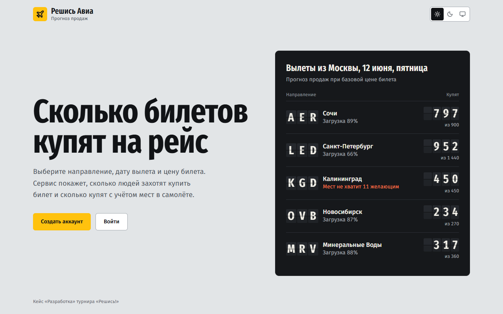
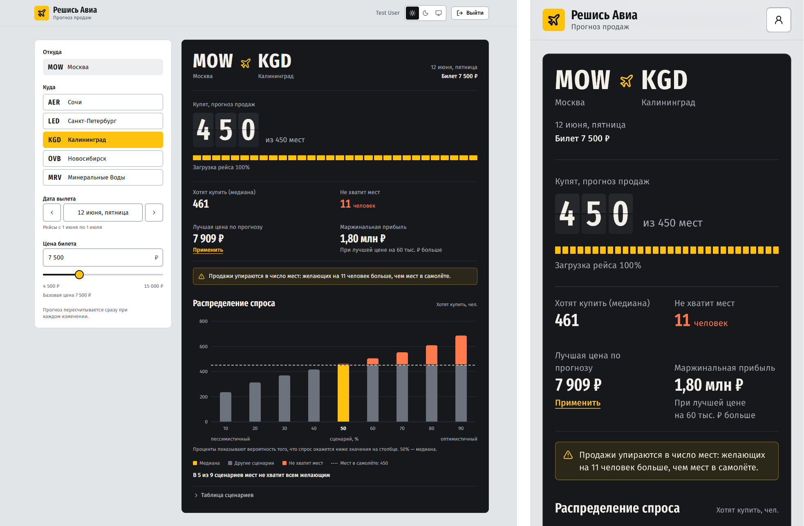
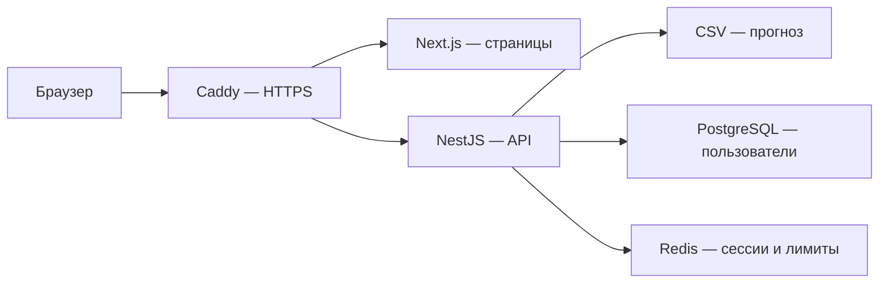

# Решись Авиа

Сервис прогноза продаж авиабилетов для кейса «Разработка» турнира «Решись!». Выберите направление, дату вылета и цену билета: сервис покажет, сколько людей захотят купить билет и сколько купят с учётом мест в самолёте.

Сайт: [avia.aexd.ru](https://avia.aexd.ru). Тестовый вход — [ниже](#тестовый-доступ).

<p><picture>
  <source media="(prefers-color-scheme: dark)" srcset="docs/screenshots/landing-dark.png">
  
</picture></p>

<p><picture>
  <source media="(prefers-color-scheme: dark)" srcset="docs/screenshots/forecast-dark.png">
  
</picture></p>

## Что умеет

Вариант C: страница на Next.js и backend API на NestJS. Все расчёты делает backend.

Функции кейса:

- прогноз продаж по направлению, дате и цене с учётом мест в самолёте;
- график спроса при введённой цене: девять сценариев и линия числа мест;
- регистрация;
- вход и выход;
- размещение на хостинге: сайт работает на своём сервере по HTTPS.

Сверх кейса:

- прогноз пересчитывается сразу, без кнопки;
- видно загрузку рейса и сколько желающих не поместятся;
- лучшая цена - та, при которой прибыль рейса наибольшая. Кнопка «Применить» подставляет её в форму;
- в календаре под каждой датой видна загрузка рейса;
- табло прогноза на главной, светлая и тёмная темы, версия для телефона.

## Расчёт

Сервис считает по моему прогнозу спроса из блока «Искусственный интеллект», `data/my_forecast.csv`. Исходный файл кейса `data/seasonal_forecast.csv` оставлен для тестов, параметры маршрутов лежат в `data/routes.csv`.

```text
желают = 0.5_base_demand − price_sensitivity × (цена − base_price)
купят = min(seats, max(0, желают))
```

Пример: Сочи, 1 июня, 9 347 ₽.

```text
желают = 837 − 0.141 × (9347 − 9000) = 788.073
купят = min(900, 788.073) = 788.073
```

График считается по той же формуле для девяти сценариев спроса, от 0.1 до 0.9. Сценарий 0.5 - медиана, он совпадает с основным прогнозом.

Лучшая цена - цена в диапазоне маршрута, при которой наибольшая прибыль:

```text
прибыль = (цена − cost_per_passenger) × купят
```

С ценой `0.5_price` из файла она совпадает с точностью до нескольких рублей: спрос в файле округлён до целых людей.

Чтобы локально считать по другому прогнозу, замените `data/my_forecast.csv` файлом того же формата и перезапустите backend. В продакшене файл включён в Docker-образ, поэтому после замены нужен новый билд и деплой. Табло на главной посчитано заранее: его числа также нужно обновить в `apps/frontend/components/landing/departure-board.tsx`.

## Стек

Фронтенд: Next.js 16, React 19, Tailwind CSS 4, Recharts. Бэкенд: NestJS 11, Prisma 6, PostgreSQL для пользователей, Redis для сессий и лимитов запросов. Прогноз читается из CSV в память. Общие типы фронтенда и бэкенда лежат в `packages/shared`.



Пароли хранятся как хеш argon2id, сессия - в httpOnly-куке. Прогноз доступен только после входа.

## Запуск локально

Нужны Node.js 22 и Docker. Из корня проекта:

```bash
cp .env.example .env
cp apps/backend/.env.example apps/backend/.env
cp apps/backend/.env.test.example apps/backend/.env.test
cp apps/frontend/.env.example apps/frontend/.env.local
npm install
npm run dev
```

Сайт откроется на http://localhost:3500, API - на http://localhost:3501/api/v1, документация API - на http://localhost:3501/docs.

## Тесты и проверки

```bash
npm run test:all                             # модульные и e2e-тесты
npm --prefix apps/backend run typecheck
npm --prefix apps/frontend run typecheck
npm --prefix apps/backend run lint
npm --prefix apps/frontend run lint
npm run smoke -- https://avia.aexd.ru/api/v1 # проверка живого сайта
```

Тесты проверяют формулу, сценарии, ограничение мест, лучшую цену, календарь, чтение CSV, регистрацию и вход. `smoke` проходит восемь шагов на работающем API, от регистрации до выхода, и сверяет прогноз с формулой. Те же тесты GitHub Actions запускает на каждый push в main и на pull request.

## API

Обычно успешный ответ имеет вид `{ "data": ..., "error": null }`, при ошибке - `{ "data": null, "error": { "code": ..., "message": ... } }`. Исключение - успешный выход: HTTP 204 без тела.

```bash
API_URL=http://localhost:3501/api/v1
COOKIE_FILE=$(mktemp)

curl -sS -c "$COOKIE_FILE" "$API_URL/auth/login" \
  -H 'Content-Type: application/json' \
  --data '{"email":"<почта>","password":"<пароль>"}'

curl -sS -b "$COOKIE_FILE" "$API_URL/routes"

curl -sS -b "$COOKIE_FILE" \
  "$API_URL/forecast?origin=MOW&destination=AER&date=2026-06-01&price=9347"

curl -sS -b "$COOKIE_FILE" \
  "$API_URL/forecast/calendar?origin=MOW&destination=AER&price=9347"

curl -sS -b "$COOKIE_FILE" -X POST "$API_URL/auth/logout"
rm "$COOKIE_FILE"
```

- `/routes` - маршруты, даты рейсов и диапазоны цен.
- `/forecast` - прогноз на рейс: места, «желают» и «купят», девять сценариев для графика и `pricing` с прибылью и лучшей ценой.
- `/forecast/calendar` - прогноз на все даты маршрута при одной цене, для календаря.

Ответ `/forecast` для примера выше:

```json
{
  "data": {
    "route": "MOW-AER",
    "name": "Москва — Сочи",
    "date": "2026-06-01",
    "seats": 900,
    "price": 9347,
    "basePrice": 9000,
    "priceSensitivity": 0.141,
    "priceMin": 5400,
    "priceMax": 18000,
    "priceOutOfRange": false,
    "simple": {"wants":788.073,"sales":788.073},
    "scenarios": [
      {"quantile":0.1,"wants":679.073,"sales":679.073,"limitedBySeats":false},
      {"quantile":0.2,"wants":716.073,"sales":716.073,"limitedBySeats":false},
      {"quantile":0.3,"wants":742.073,"sales":742.073,"limitedBySeats":false},
      {"quantile":0.4,"wants":766.073,"sales":766.073,"limitedBySeats":false},
      {"quantile":0.5,"wants":788.073,"sales":788.073,"limitedBySeats":false},
      {"quantile":0.6,"wants":809.073,"sales":809.073,"limitedBySeats":false},
      {"quantile":0.7,"wants":832.073,"sales":832.073,"limitedBySeats":false},
      {"quantile":0.8,"wants":859.073,"sales":859.073,"limitedBySeats":false},
      {"quantile":0.9,"wants":897.073,"sales":897.073,"limitedBySeats":false}
    ],
    "limitedBySeats": false,
    "pricing": {"costPerPassenger":4200,"margin":4056211.731,"bestPrice":9568,"bestSales":756.912,"bestMargin":4063103.616}
  },
  "error": null
}
```

Без входа API отвечает 401, на неверную цену - 400, на неизвестный маршрут или дату - 404.

## Деплой

Сайт работает на VPS с 2 vCPU и 2 ГБ памяти под Ubuntu 24.04: Docker Compose, перед сервисами Caddy, он сам получает HTTPS-сертификат. База и Redis наружу не открыты.

Первый раз: направить домен на сервер, поставить Docker, склонировать репозиторий и создать `.env` по образцу `.env.example`.

Каждая выкладка - одна команда на сервере:

```bash
./scripts/deploy.sh
```

Скрипт забирает свежий код, собирает образы, применяет миграции, перезапускает сервисы, проверяет сайт снаружи и запускает `smoke`. В конце удаляет старые образы.

Откат: `git checkout <коммит> && ./scripts/deploy.sh --no-pull`. Обратно: `git checkout main && ./scripts/deploy.sh`.

## Тестовый доступ

- Сайт: https://avia.aexd.ru
- Почта: `testuser@aexd.ru`
- Пароль: `ubuntu2404`

Можно зарегистрироваться и самому.

## Как я работал над проектом

В разработке я использовал Claude Code с моделью Claude Opus 5.5.

Сразу определил, что хочу получить: выбрал вариант C, стек, составил ТЗ с формулой, API, страницами и чек-листом ручных проверок.
По этому плану ИИ помогал писать код, а я проверял результат и решал, что переделать.

Свой прогноз `my_forecast.csv` я подготовил в блоке «Искусственный интеллект». Также сам арендовал VPS, настроил домен, выложил сайт и проверил его работу. При реализации ИИ помог с бэкендом прогноза, страницей, графиком, оформлением, тестами, smoke и скриптом деплоя.

Чтобы работа не разваливалась при изменениях, я собрал основные правила в [AGENTS.md](AGENTS.md): стек, формат API, команды проверок и ошибки, которые уже встречались в процессе.

## Как я проверял работу ИИ

- Посчитал пример сам: 837 - 0,141 * 347 = 788,073. Сайт показывает 788.
- Проверил ограничение мест: Калининград, 12 июня. Хотят 461, мест 450, сайт показывает 450 и «не хватит 11».
- Сверил лучшую цену с ценой из файла: разница не больше 8 ₽.
- Прогнал тесты, 49 модульных и 33 e2e, и `smoke` на живом сайте.
- Прошел сайт с компьютера и с телефона, в светлой и темной теме.

Где ИИ ошибся:

1. На телефоне отступы в шапке были неровными, а переключателя темы не было. Выровнял шапку и добавил переключатель в меню аккаунта.
2. В тёмной теме выбранное направление при наведении становилось чёрным и сливалось с фоном. Исправил цвет при наведении.
3. ИИ предложил слишком сложную схему сборки под слабый сервер. Отказался от неё и оставил одну команду `./scripts/deploy.sh`.
